<a href="https://aleessandrohr.dev.br">
  <picture>
    <source media="(prefers-color-scheme: dark)" srcset="assets/profile-header-dark.svg" />
    <source media="(prefers-color-scheme: light)" srcset="assets/profile-header-light.svg" />
    
  </picture>
</a>

  <a href="https://aleessandrohr.dev.br">Portfolio</a> &nbsp;·&nbsp;
  <a href="https://www.linkedin.com/in/aleessandrohr/">LinkedIn</a> &nbsp;·&nbsp;
  <a href="mailto:alessandro.henri.r@gmail.com">Email</a>

## About me

I'm a mid-level Full-Stack Developer working with TypeScript, specializing in front-end development with React.js and Next.js, back-end development with Node.js and PostgreSQL, and mobile development with React Native and Expo. I have experience with micro frontend architectures using Module Federation, microservices integration, infrastructure, and AI solutions. I'm pursuing a degree in Computer Engineering at the Federal University of Maranhão (UFMA).

## Skills

**Languages** 
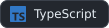 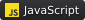 

**Front-end** 
 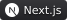 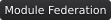 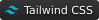 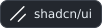

**Back-end** 
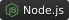 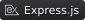 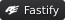  

**Mobile** 
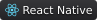 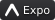

**Databases** 
 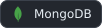

**Infrastructure & DevOps** 
 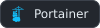 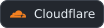 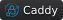

**AI tools** 
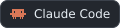 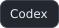 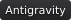 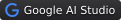

**Tooling & integration** 
 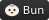 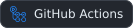 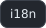 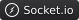

## Selected work

- **[Personal portfolio](https://aleessandrohr.dev.br)**: visual and terminal navigation, a resume page and shared content across both modes. Built with Next.js and TypeScript. [Source code](https://github.com/aleessandrohr/portfolio).
- **Workspace · Anuntech**: corporate SaaS with a modular architecture using Module Federation. Implemented bookmarks as its main productivity tool and real-time notifications with Socket.io.
- **Digitaliza Aí**: team MVP developed with AI in 4 days during an EQT LAB hackathon. Finished 5th out of 11 teams.
- **[in.orbit](https://inorbit.aleessandrohr.dev.br)**: web application for tracking goals and weekly habits. [Try the demo](https://inorbit.aleessandrohr.dev.br/demo).
- **[Letmeask](https://letmeask.aleessandrohr.dev.br)**: web application for creating and managing live Q&A rooms.

## GitHub activity

  <picture>
    <source media="(prefers-color-scheme: dark)" srcset="assets/stats/development-dark.svg" />
    <source media="(prefers-color-scheme: light)" srcset="assets/stats/development-light.svg" />
    
  </picture>
  &nbsp;&nbsp;&nbsp;
  <picture>
    <source media="(prefers-color-scheme: dark)" srcset="assets/stats/languages-dark.svg" />
    <source media="(prefers-color-scheme: light)" srcset="assets/stats/languages-light.svg" />
    
  </picture>

<picture>
  <source media="(prefers-color-scheme: dark)" srcset="assets/stats/contributions-dark.svg" />
  <source media="(prefers-color-scheme: light)" srcset="assets/stats/contributions-light.svg" />
  
</picture>

  

